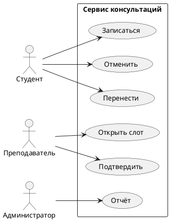

## Цель работы

Научиться превращать короткое описание задачи в набор проверяемых требований и определять границы системы. Результат работы станет входом для следующих занятий: по этим требованиям вы построите прецеденты, классы и модель данных.

В работе используется учебный кейс «Сервис записи на консультации». Его описание намеренно короткое, как реальное письмо заказчика.

> [!KEY]
> Требование это не пожелание и не функция сама по себе. Требование фиксирует проверяемый результат, который можно подтвердить тестом или демонстрацией.

## Исходное описание

> Нужен сервис записи на консультации для колледжа. Студент видит свободные слоты преподавателя, записывается, отменяет или переносит запись. Преподаватель открывает слоты и подтверждает записи. Администратор видит отчёты и может снять ограничения. Система отправляет письма и добавляет события в календарь.

В описании уже есть роли, действия и внешние системы, но нет проверяемых критериев. Неясно, сколько времени действует слот, можно ли записаться на прошедшее время, что происходит при отмене, кто видит персональные данные. Эти вопросы нужно закрыть требованиями.

## Задание 1. Цель и границы

Сначала отделите цель системы от списка функций. Цель отвечает на вопрос «зачем», функции на вопрос «что делает».

Заполните таблицу.

| Вопрос | Ответ |
|---|---|
| Какую проблему решает сервис? |  |
| Кто получает пользу? |  |
| Что входит в систему? |  |
| Что остаётся снаружи? |  |
| Как поймём, что цель достигнута? |  |

Ориентир для проверки: цель не должна звучать как «сделать красивый интерфейс» или «автоматизировать всё». Хорошая цель измерима: например, «студент записывается на консультацию без переписки с преподавателем».

Границы важны не меньше цели. Внешними могут быть почтовый сервис, календарь, система аутентификации колледжа. Если провести границу слишком широко, проект разрастётся. Если слишком узко, студент не сможет получить подтверждение.

## Задание 2. Акторы

**Актор** это роль, которая взаимодействует с системой и получает от неё наблюдаемый результат. Актор не обязательно человек: внешняя система тоже может быть актором.

Заполните таблицу для кейса.

| Актор | Что делает | Что получает | Внутри или снаружи |
|---|---|---|---|
| Студент |  |  |  |
| Преподаватель |  |  |  |
| Администратор |  |  |  |
| Почтовый сервис |  |  |  |

Проверьте себя: если роль отличается только правами доступа, это может быть один актор с разными правами, а не два разных актора. Например, «студент» и «староста» могут быть одной ролью, если староста делает те же действия, но для группы.

> [!PITFALL] Актор это не должность
> «Иванов И.И.» не актор. Актор это роль: студент, преподаватель, администратор, внешний календарь. Один человек может выступать в нескольких ролях, и это нормально.

## Задание 3. User stories

User story фиксирует потребность в коротком виде:

> Как **роль**, я хочу **действие**, чтобы **ценность**.

У каждой истории должны быть **критерии приёмки**. Удобный формат: Given (дано), When (когда), Then (тогда).

Пример:

> Как студент, я хочу видеть только свободные слоты, чтобы не тратить время на занятые.
>
> Дано: у преподавателя есть свободный и занятый слот.
> Когда: студент открывает расписание.
> Тогда: занятый слот не отображается как доступный для записи.

Составьте не менее пяти историй. Обязательно покройте:

1. запись на свободный слот;
2. отмену записи;
3. перенос записи;
4. открытие слота преподавателем;
5. просмотр отчёта администратором.

Для каждой истории напишите 1–3 критерия приёмки. Критерий должен быть проверяемым: в нём есть условие, действие и наблюдаемый результат.

| № | User story | Критерий приёмки |
|---|---|---|
| 1 |  |  |
| 2 |  |  |
| 3 |  |  |
| 4 |  |  |
| 5 |  |  |

## Задание 4. Нефункциональные требования

Функциональные требования говорят, **что** делает система. Нефункциональные говорят, **как** и **при каких условиях** она это делает: скорость, надёжность, безопасность, доступность, удобство.

Сформулируйте не менее четырёх нефункциональных требований с числами или проверяемыми условиями.

| Характеристика | Требование | Как проверить |
|---|---|---|
| Производительность |  |  |
| Доступность |  |  |
| Безопасность |  |  |
| Удобство |  |  |

Плохие формулировки и их исправления:

| Плохо | Почему | Лучше |
|---|---|---|
| Система должна работать быстро | «Быстро» не имеет критерия | Список слотов открывается не дольше 2 секунд при 50 одновременных пользователях |
| Система должна быть удобной | Нет проверяемого результата | Студент записывается на свободный слот не более чем за 3 экрана без подсказок |
| Система должна быть безопасной | Слишком широко | Студент видит только свои записи, преподаватель только свои слоты, администратор видит отчёты без персональных данных |
| Система должна отправлять письма | Не указано когда и при каких условиях | Письмо о подтверждении уходит не позднее 1 минуты после подтверждения записи |

> [!TRADEOFF] Требования тянут архитектуру
> Если требование говорит «работать при 500 одновременных пользователях», это влияет на выбор базы данных и кэша. Если требование говорит «хранить историю 5 лет», это влияет на объём и резервное копирование. Нефункциональные требования нельзя добавить в конце: они закладываются в архитектуру.

## Задание 5. Границы и прецеденты

Нарисуйте черновую схему границ системы. Внутри рамки разместите прецеденты, снаружи акторов и внешние системы. Схема не обязана быть красивой, но должна отвечать на вопросы: кто взаимодействует с системой, какие результаты получает, что остаётся снаружи.

<figure class="diagram">
<svg viewBox="0 0 680 400" role="img" aria-labelledby="fig2-title fig2-desc">
  <title id="fig2-title">Границы сервиса консультаций</title>
  <desc id="fig2-desc">Студент, преподаватель и администратор находятся снаружи границы системы. Внутри расположены прецеденты записи, отмены, переноса, открытия слота, подтверждения и отчёта.</desc>
  <defs>
    <marker id="ar2" viewBox="0 0 10 10" refX="8" refY="5" markerWidth="6" markerHeight="6" orient="auto-start-reverse">
      <path d="M2 1L8 5L2 9" fill="none" stroke="context-stroke" stroke-width="1.5" stroke-linecap="round" stroke-linejoin="round"/>
    </marker>
  </defs>
  

  <rect class="uc-boundary" x="180" y="30" width="320" height="330" rx="16"/>
  <text class="uc-a" x="340" y="20" text-anchor="middle">Граница системы</text>

  <ellipse class="uc" cx="270" cy="90" rx="66" ry="22"/>
  <text class="uc-t" x="270" y="95" text-anchor="middle">Записаться</text>
  <ellipse class="uc" cx="270" cy="160" rx="66" ry="22"/>
  <text class="uc-t" x="270" y="165" text-anchor="middle">Отменить</text>
  <ellipse class="uc" cx="270" cy="230" rx="66" ry="22"/>
  <text class="uc-t" x="270" y="235" text-anchor="middle">Перенести</text>
  <ellipse class="uc" cx="410" cy="90" rx="66" ry="22"/>
  <text class="uc-t" x="410" y="95" text-anchor="middle">Открыть слот</text>
  <ellipse class="uc" cx="410" cy="160" rx="66" ry="22"/>
  <text class="uc-t" x="410" y="165" text-anchor="middle">Подтвердить</text>
  <ellipse class="uc" cx="410" cy="230" rx="66" ry="22"/>
  <text class="uc-t" x="410" y="235" text-anchor="middle">Отчёт</text>

  <text class="uc-s" x="62" y="98" text-anchor="middle">Студент</text>
  <circle cx="62" cy="116" r="8" fill="none" stroke="var(--ink-2)" stroke-width="1.4"/>
  <path d="M62 124 L62 146 M50 132 L74 132 M62 146 L52 164 M62 146 L72 164" fill="none" stroke="var(--ink-2)" stroke-width="1.4" stroke-linecap="round"/>

  <text class="uc-s" x="62" y="238" text-anchor="middle">Преподаватель</text>
  <circle cx="62" cy="256" r="8" fill="none" stroke="var(--ink-2)" stroke-width="1.4"/>
  <path d="M62 264 L62 286 M50 272 L74 272 M62 286 L52 304 M62 286 L72 304" fill="none" stroke="var(--ink-2)" stroke-width="1.4" stroke-linecap="round"/>

  <text class="uc-s" x="618" y="158" text-anchor="middle">Администратор</text>
  <circle cx="618" cy="176" r="8" fill="none" stroke="var(--ink-2)" stroke-width="1.4"/>
  <path d="M618 184 L618 206 M606 192 L630 192 M618 206 L608 224 M618 206 L628 224" fill="none" stroke="var(--ink-2)" stroke-width="1.4" stroke-linecap="round"/>

  <path class="uc-line" d="M78 120 L204 95"/>
  <path class="uc-line" d="M78 128 L204 158"/>
  <path class="uc-line" d="M78 136 L204 226"/>
  <path class="uc-line" d="M78 268 L204 238"/>
  <path class="uc-line" d="M78 262 L344 94"/>
  <path class="uc-line" d="M78 256 L344 158"/>
  <path class="uc-line" d="M602 186 L476 232"/>
  <path class="uc-line" d="M602 180 L476 166"/>
</svg>
<figcaption><b>Рис. 1.</b> Акторы и внешние роли находятся снаружи границы, прецеденты внутри. Линии показывают, кто инициирует или получает результат. Внешние системы (почта, календарь) на этой схеме не показаны, чтобы не перегружать черновик.</figcaption>
</figure>

Схему можно выполнить в draw.io, PlantUML или на бумаге. Главное не оформление, а проверка: каждый прецедент должен быть связан хотя бы с одним актором, а каждый актор должен иметь хотя бы один результат.

Пример PlantUML для этой схемы:

## Задание 6. Проверка требований

Проверьте каждую user story и каждое нефункциональное требование по чек-листу.

| Критерий | Вопрос | Да или нет |
|---|---|---|
| Однозначность | Два человека прочитают одинаково? |  |
| Проверяемость | Можно подтвердить тестом или демонстрацией? |  |
| Атомарность | В требовании одна мысль? |  |
| Критерий вместо оценки | Нет слов «быстро», «удобно», «надёжно» без числа? |  |
| Источник | Понятно, откуда требование взялось? |  |
| Граница | Понятно, что входит в систему, а что нет? |  |

Если требование не проходит проверку, перепишите его. Не оставляйте в отчёте плохую формулировку рядом с пометкой «плохо»: отчёт должен содержать итоговый набор требований, с которым можно работать.

> [!CHECK] Чем user story отличается от требования?
> User story описывает потребность и ценность в короткой форме, а требование фиксирует проверяемый результат. User story без критериев приёмки остаётся пожеланием. Критерии приёмки превращают историю в набор проверяемых требований.

> [!CHECK] Почему «система должна быть удобной» нельзя считать требованием?
> В нём нет проверяемого критерия и границ. Непонятно, для кого удобной, в какой операции, за какое время. Такое пожелание нужно разложить на конкретные сценарии и измеримые условия.

## Задание 7. Отчёт

В отчёт включите:

1. Цель и границы системы.
2. Таблицу акторов.
3. Не менее пяти user stories с критериями приёмки.
4. Не менее четырёх нефункциональных требований с проверкой.
5. Схему границ и прецедентов.
6. Заполненный чек-лист проверки.
7. Вывод: какие вопросы остались открытыми и какие требования нужно согласовать с заказчиком.

Файл сохраните по шаблону `ФИО_Практика_1.docx` или `ФИО_Практика_1.pdf`.

## Контрольные вопросы

1. Чем цель системы отличается от списка функций?
2. Почему актор это роль, а не конкретный человек?
3. Какие элементы должны быть у критерия приёмки?
4. Чем функциональное требование отличается от нефункционального?
5. Зачем фиксировать границы системы до построения диаграмм?

## Критерии оценки

- **5**: все задания выполнены, требования проверяемые, есть не менее пяти историй и четырёх нефункциональных требований, схема согласована с текстом, вывод содержит открытые вопросы.
- **4**: задания выполнены, но есть неточности в критериях приёмки или один актор пропущен.
- **3**: требования собраны частично, критерии приёмки расплывчаты, схема не согласована с текстом отчёта.
